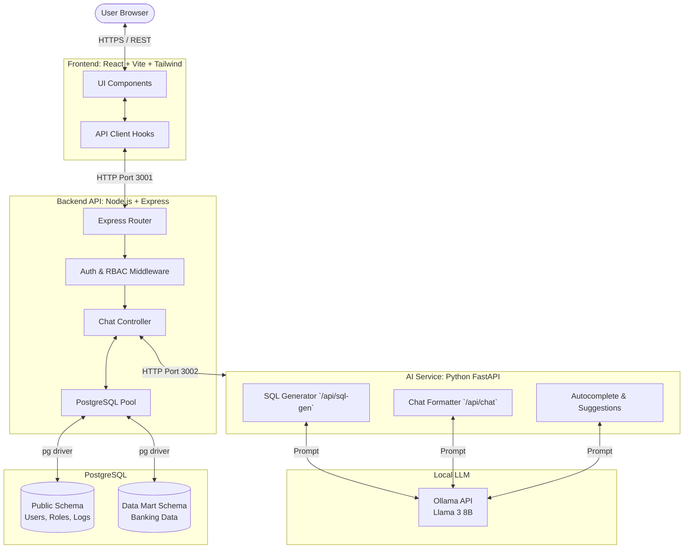
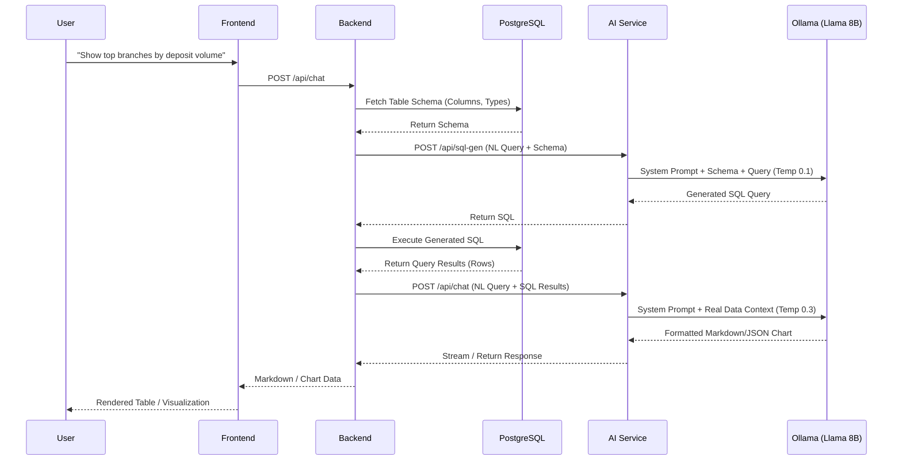

# XYZ Bank Data Insight Agent Architecture

## System Overview

The XYZ Bank Data Insight Agent is an enterprise analytics platform composed of a 3-tier architecture: a React frontend, a Node.js API backend, and a Python-based AI microservice, all backed by a PostgreSQL database.

It is designed to query banking data marts using natural language, generate data visualizations (charts/tables), and manage user access with strict isolation between application metadata and banking data.

## High-Level Architecture Diagram

## The Text-to-SQL Data Flow

The core capability of the Insight Agent is its ability to convert natural language queries into accurate data responses without hallucinating numbers. This is achieved via a robust Text-to-SQL pipeline:

## Component Details

### 1. Frontend (Client)
- **Tech Stack:** React 18, TypeScript, Vite, Tailwind CSS, shadcn/ui.
- **Responsibilities:** Renders the chat interface, handles file uploads (CSV/Excel) for instant analysis, renders AI-generated markdown and JSON configurations into interactive Recharts visualizations.

### 2. Backend (API Server)
- **Tech Stack:** Node.js 18, Express 5, PostgreSQL (pg).
- **Responsibilities:** Serves as the central orchestrator. It manages JWT authentication, rate limiting, and RBAC. For analysis, it fetches table schemas from PostgreSQL, communicates with the AI microservice to get SQL, safely executes the SQL, and sends the raw data back to the AI for final formatting.

### 3. AI Service (Microservice)
- **Tech Stack:** Python 3.9, FastAPI, Pandas.
- **Responsibilities:** An internal microservice isolated from the public network. It has multiple specialized endpoints:
  - `/api/sql-gen`: Uses a low-temperature (0.1) LLM call strictly to convert questions and schemas into standard PostgreSQL queries.
  - `/api/chat`: Takes the raw row outputs from the Backend's SQL execution and builds a final natural language or JSON visualization response.
  - `/api/autocomplete`: Provides predictive typing suggestions for the chat UI.

### 4. Database (PostgreSQL)
- **Isolation Strategy:** Uses a two-schema design for security:
  - `public`: Holds application metadata (users, profiles, RBAC assignments, audit logs).
  - `data_mart`: A completely isolated schema used for imported enterprise banking data. Generated SQL queries are strictly constrained to only read from this schema.

## Security & Reliability
- **Hallucination Prevention:** The LLM is never allowed to "guess" banking metrics. The SQL is generated and executed on the real database, and the AI is prompted to build its final answer strictly using the returned rows.
- **SQL Injection Prevention:** The AI generator is prompted to only emit `SELECT` statements and never DDL/DML. The Backend serves as a strict gateway.
- **Audit Logging:** Every user login, query, and administrative action is logged to the database with IP tracking.
